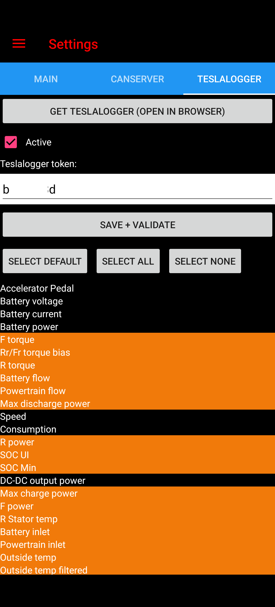

# ScanMyTesla

ScanMyTesla is a smartphone app that makes it possible to read data from the Tesla that is not available via the regular Tesla app and therefore normally not accessible for TeslaLogger either.
For this purpose, a so-called OBD2 adapter must be installed in the vehicle, which is then paired via Bluetooth with the "SMT" app. In a second step, the app can now be configured so that it transmits the selected live data to the TeslaLogger installation at home and thus enriches the already existing data collection with further information such as the actually available battery capacity, the battery temperature, etc.
The coupling of the app with TeslaLogger is done similarly as before with the integration with "A Better Routeplanner" with a unique token. The token for SMT can be found in the settings dialog as "Tasker Token". The checkmark at "ScanMyTesla integration" must also be set here, because only then does TeslaLogger fetch the data from the server. The value for the token must then be entered in the app under "Settings" - "TeslaLogger". It looks like this:

As soon as the OBD2 adapter is coupled with the app according to the instructions and runs during a trip (this can also be in the background), the selected data points are transmitted live to the TeslaLogger.
The installation of the OBD2 adapter is slightly different from vehicle to vehicle; usually access is found at the Model 3 and Model Y at the bottom in the center console in front of the rear seat row. Here the adapter must be integrated into the data line with a Y-cable. It is recommended to make the vehicle powerless beforehand. This is also different from vehicle to vehicle; at Model 3/Y there is a switch for this under the rear seat on the left side. The installation can look like this after opening the cover:

If you do not trust yourself to install it, you should definitely visit a Tesla body shop. Suitable adapters and sources are documented on the "Scan My Tesla" homepage.
How the data from the app then flows into the normal data of the TeslaLogger can be found in the dashboards for degradation ("Nominal full pack"), charging sessions (especially at fast chargers, "Cell temperature", "Cell imbalance", etc.) as well as in the usual "Trips".
Your own queries against the raw app data (the `can` table) are described in [Use ScanMyTesla data in your own dashboards](/docs/extras/scanmytesla-dashboards).

## Does the transfer work?

The settings dialog shows "ScanMyTesla last received". If that value is a long time ago or missing completely, check the following in this order:

1. Is the "ScanMyTesla integration" checkbox set?
2. Is the token entered in the app identical to the "Tasker Token"? Even a single mistyped character means the data sits on the server but is never fetched.
3. Has TeslaLogger already fetched the vehicle list from Tesla successfully? Fetching the app data only starts after that.

The app generally only sends values that have changed since the last packet. So gaps in the dashboard curves do not mean the transfer is broken – the last reported value is kept and continued in the curve.

## For app developers

Anyone who wants to connect their own app (not just ScanMyTesla) to TeslaLogger: the address, packet format, timestamps, allowed signal IDs and the limits of the sending frequency are described in the [interface for app data](/docs/extras/scanmytesla-api).
