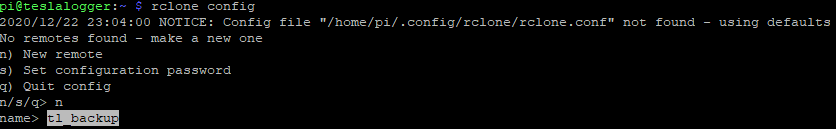
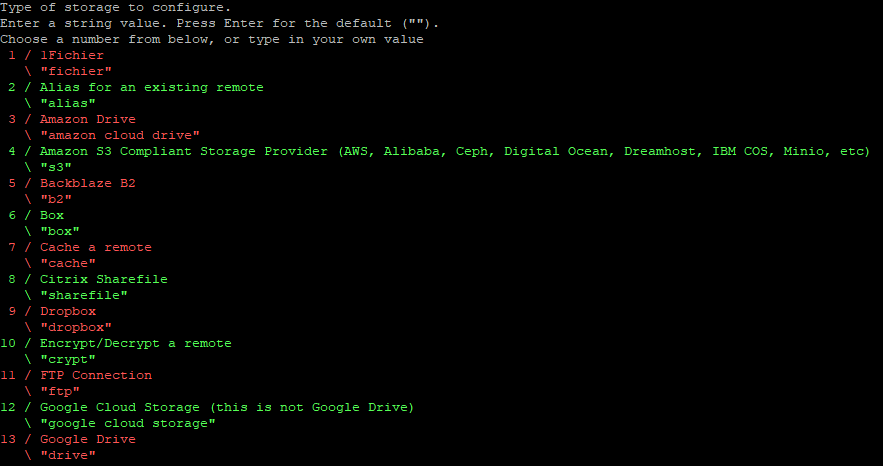
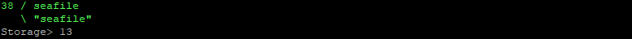
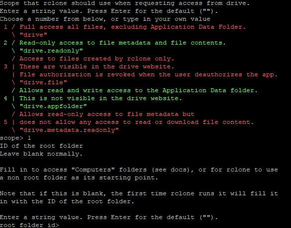
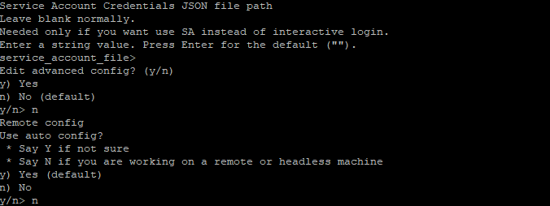
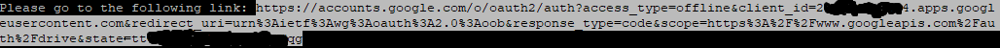
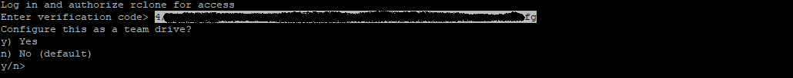
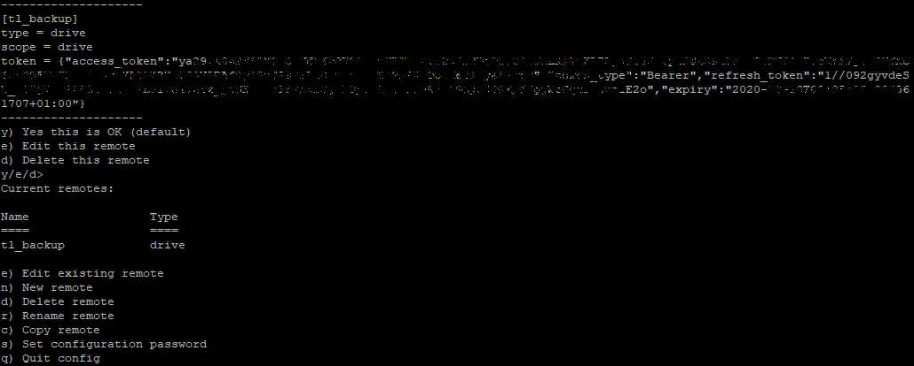

# Automatically upload backups to the cloud or a NAS

The example below shows Google Drive; other (cloud) services work in a similar way with rclone.

### Assumptions about the system:
*IP address*: 192.168.1.30

*Username*: pi (adjust the commands below if it differs)

### Setting up rclone
- Connect to Teslalogger via SSH: `ssh -L 53682:localhost:53682 pi@192.168.1.30`
(`-L 53682:localhost:53682` is required for rclone)
- If it is not installed yet, install *rclone*: `sudo apt-get install -y rclone`
- Run `rclone config`
- Create a connection with **n** (e.g.: "tl_backup") and press **ENTER**

- Find the list number for Google Drive, enter it and press **ENTER**


- Use this how-to for *client_id* and *client_secret*:
  https://rclone.org/drive/#making-your-own-client-id
- **3** and **ENTER** for *scope*, **ENTER** for *service_account_file*, **ENTER** for *Edit advanced config*, **ENTER** for *Use auto config*


- Copy the link that is shown and open it in a browser. Sign in with the Google account and allow access.

Then press **ENTER** for *Shared Drive (Team Drive)*

The configuration with the tokens is displayed; confirm with **ENTER** and leave rclone with **q**

### Create the backup script
- Open nano: `nano /home/pi/backup.sh` and paste the following:
```
#!/bin/bash

BACKUP_DIR="/etc/teslalogger/backup"
REMOTE_NAME="tl_backup:Backup/teslalogger"

/usr/bin/rclone copy --update --verbose --transfers 3 --contimeout 60s --timeout 300s --retries 3 --low-level-retries 10 --stats 1s "$BACKUP_DIR" "$REMOTE_NAME" --drive-use-trash=false
```

The paths must be adjusted, especially for a Docker installation!

`tl_backup:Backup/teslalogger` means: a folder called Backup is created, and inside it a folder called teslalogger.

If several applications should be stored in the same "Backup" folder, this is recommended:

`REMOTE_NAME="tl_backup,root_folder_id=abcdefg:/teslalogger"`


where `abcdef` is the folder ID that you see in the URL when you open the folder in Google Drive with a web browser:


This command copies all backup files into the folder "Backup/teslalogger" using the rclone *tl_backup* connection created earlier. Adjust if needed.
After the first test it is recommended to use `move` instead of `copy`. The uploaded files are then deleted from the local folder.

- Save the file: **CTRL+X**, **y**, **ENTER**
- Make it executable: `chmod +x /home/pi/backup.sh`
- Test it: `chmod +x /home/pi/backup.sh`
- With many backups the first run takes longer. Success looks like this:


### Run the backup script every night

#### Set up the backup service:
`sudo nano /etc/systemd/system/backup-rclone.service`

Paste the following and adjust user and script path if necessary:

```[Unit]
Description=Rclone backup and cleanup
After=network-online.target
Wants=network-online.target

[Service]
Type=oneshot
User=pi
ExecStart=/bin/bash /home/pi/backup.sh

[Install]
WantedBy=multi-user.target
```

#### Set up the timer
`sudo nano /etc/systemd/system/backup-rclone.timer`

```
[Unit]
Description=Timer for the nightly rclone backup

[Timer]
OnCalendar=*-*-* 04:00:00
Persistent=true

[Install]
WantedBy=timers.target
```

Then restart the systemd manager so the new settings are picked up:
`sudo systemctl daemon-reload`

Enable the timer:
`sudo systemctl enable --now backup-rclone.timer`

And check the status: 
`systemctl status backup-rclone.timer`

"Active:" should read *active*

Start the backup service manually right away for testing:
`sudo systemctl start backup-rclone.service`
